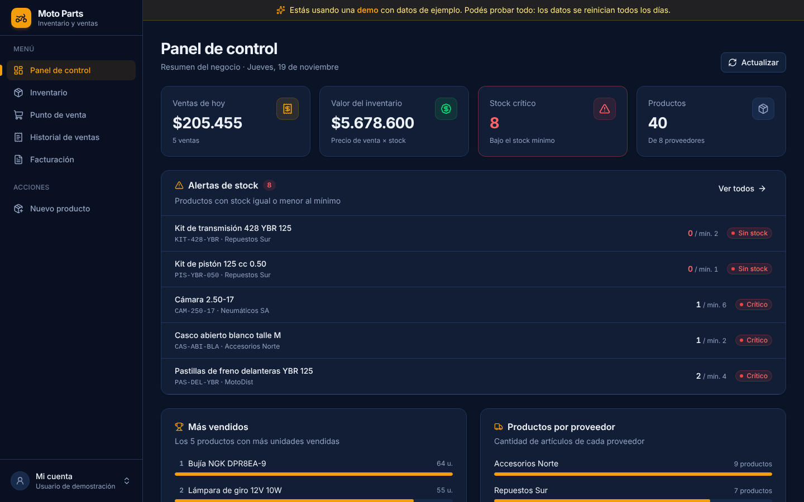
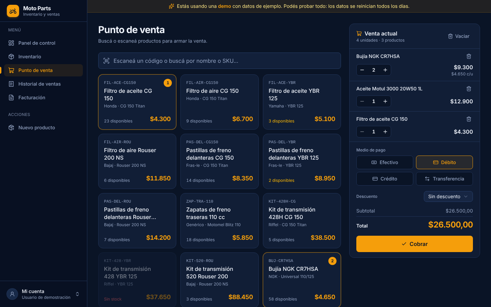
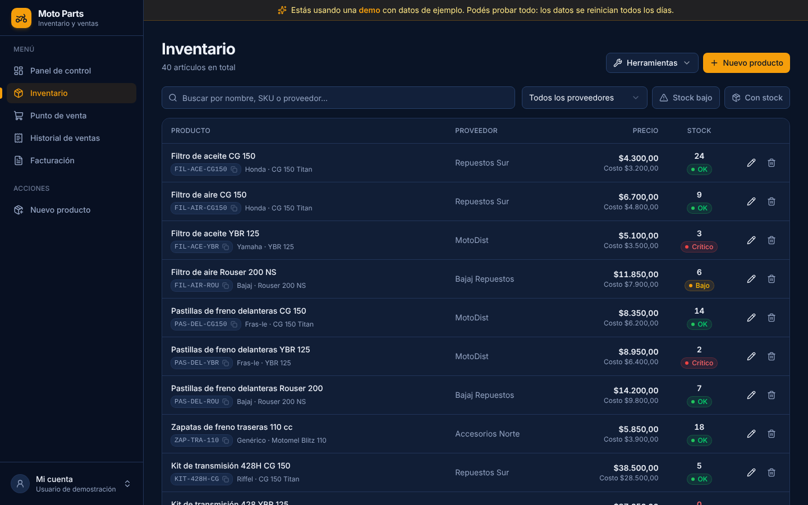
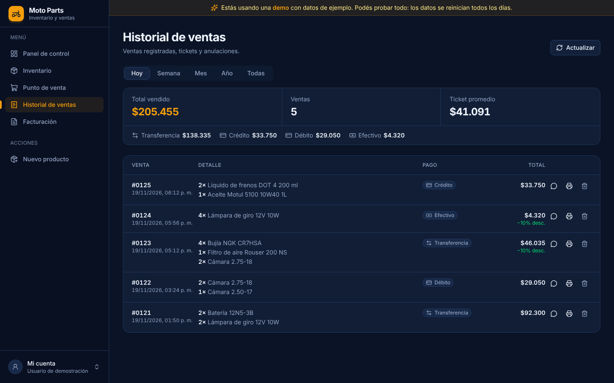
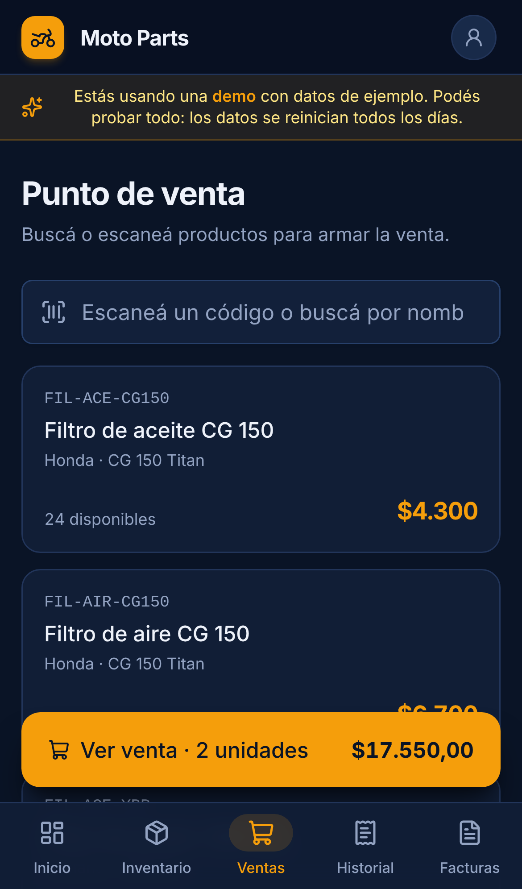

<div align="center">

# 🏍️ Moto Parts

**Sistema de inventario y punto de venta para una casa de repuestos de motos.**

### [▶ Probar la demo](https://motoparts-demo.vercel.app)

Entrás con un clic, sin registrarte. Usa datos de ejemplo que se reinician todos los días: podés vender, cargar productos y probar todo.




</div>

Lo desarrollé a medida para que un negocio de repuestos de motos lleve el control del local sin complicaciones: robusto por detrás y simple de usar en el día a día. La versión que usa el negocio es privada; la [demo](https://motoparts-demo.vercel.app) es el mismo sistema, con su propia base de datos y datos de ejemplo.

## ✨ Qué hace

- **Panel de control:** ventas del día, valor del inventario, alertas de stock bajo, más vendidos y productos por proveedor.
- **Punto de venta:** búsqueda rápida, compatible con lector de código de barras, carrito con descuentos y medios de pago, y control de stock al vender.
- **Inventario:** búsqueda y filtros, alta y edición con cálculo de margen, aumentos masivos de precios e importación de listas de proveedores desde Excel, con la cotización del dólar del día y traducción automática de nombres.
- **Historial de ventas:** resumen por período (total, ticket promedio y desglose por medio de pago), tickets para imprimir o enviar por WhatsApp y anulación con devolución de stock.
- **Facturación de proveedores:** se sube el PDF, el sistema lee número, proveedor, fechas y total, y se sigue el estado de pago con aviso de vencimientos.
- **App instalable (PWA)** en la compu o el celular, con diseño adaptado a cada pantalla.

## 📸 Capturas

<table>
  <tr>
    <td width="50%"><br><sub>Punto de venta</sub></td>
    <td width="50%"><br><sub>Inventario</sub></td>
  </tr>
  <tr>
    <td width="50%"><br><sub>Historial de ventas</sub></td>
    <td width="50%" align="center"><br><sub>En el celular</sub></td>
  </tr>
</table>

## 🛠️ Tecnologías

| Capa | Tecnología |
| --- | --- |
| Frontend y API | **Next.js 16** (App Router, Route Handlers, Proxy) + React 19 |
| Interfaz | **Tailwind CSS v4** + componentes de **shadcn/ui** (Radix) e íconos **Lucide** |
| Base de datos | **Supabase** (Postgres) con Row Level Security y funciones SQL para la lógica transaccional |
| Archivos | **Supabase Storage** (bucket privado para los PDFs de facturas) |
| Autenticación | **Supabase Auth** (email y contraseña, sesión en cookies con `@supabase/ssr`) |
| Crons | **Vercel Cron** (diario) y **GitHub Actions** (cada 2 días) → `/api/cron/keepalive` para que Supabase no pause el proyecto |
| CI/CD | **GitHub Actions** (lint, build y validación de migraciones) + deploy en **Vercel** |

## 📁 Estructura

```
src/
├── app/
│   ├── (panel)/            # Páginas protegidas: dashboard, inventario, pos, historial, facturación
│   ├── login/              # Pantalla de ingreso
│   ├── api/                # Route Handlers (reemplazan a la API .NET)
│   │   ├── productos/      # CRUD, importar, aumento-masivo, renombrar-proveedor, estadísticas
│   │   ├── ventas/         # registrar, listar y eliminar (devuelve el stock)
│   │   ├── facturas/       # CRUD, lectura del PDF (extraer) y link al archivo
│   │   ├── cotizacion/     # Cotización del dólar (dolarapi.com) para importar listas en USD
│   │   └── cron/keepalive/ # Endpoint del cron
│   ├── layout.js
│   └── manifest.js         # Manifest de la PWA
├── components/             # Pantallas de la app
│   ├── app/                # Piezas comunes (encabezado, estado vacío, campos, subida de archivos)
│   └── ui/                 # Componentes base de shadcn/ui
├── lib/
│   ├── api.js              # Funciones que usan los componentes para llamar a la API
│   ├── http.js             # Helpers de los Route Handlers (auth, errores)
│   ├── facturas/           # Lector de PDFs de facturas (+ pruebas)
│   ├── demo/               # Demo pública: datos de ejemplo y reinicio diario
│   └── supabase/           # Clientes de Supabase (navegador y servidor)
└── proxy.js                # Refresca la sesión y protege las rutas
supabase/
├── config.toml             # Configuración para el entorno local (Supabase CLI)
└── migrations/             # Esquema, RLS y funciones SQL
.github/workflows/
├── ci.yml                  # Lint + build + validación de migraciones en cada push/PR
├── keepalive.yml           # Cron cada 2 días
└── supabase-migrations.yml # Aplica migraciones a producción al hacer push a main
```

## ⚙️ Desarrollo local

Requisitos: Node.js 20.9+ y (opcional, para la base local) Docker.

```bash
npm install
```

```bash
cp .env.example .env.local
```

### Opción A: Supabase local (recomendado para desarrollar)

```bash
npx supabase start
```

El comando aplica las migraciones y muestra la `API URL` y la `Publishable key`: copialas en `.env.local`. El registro público está deshabilitado, así que creá tu usuario desde Supabase Studio (http://127.0.0.1:54323 → Authentication → Add user).

### Opción B: Proyecto de Supabase en la nube

Usá la URL y la publishable key de tu proyecto (ver "Puesta en producción").

### Levantar la app

```bash
npm run dev
```

Visitá http://localhost:3000 e ingresá con tu email y contraseña.

Pruebas del lector de facturas:

```bash
npm test
```

## 🚢 Puesta en producción

### 1. Supabase

1. Creá un proyecto en [supabase.com](https://supabase.com).
2. Aplicá el esquema con la CLI (`npx supabase link --project-ref <id>` y `npx supabase db push --remote`), o pegá cada archivo de `supabase/migrations/` **en orden** en el **SQL Editor**. La migración de facturas también crea el bucket privado `facturas` en Storage.
3. En **Authentication → Sign In / Providers**, desactivá **Allow new users to sign up** (solo deben entrar los usuarios que vos crees).
4. En **Authentication → Users → Add user**, creá el usuario administrador.
5. En **Authentication → URL Configuration**, poné la URL de Vercel como *Site URL*.

### 2. Vercel

1. Importá el repositorio de GitHub en [vercel.com](https://vercel.com) (detecta Next.js automáticamente).
2. Cargá las variables de entorno:
   - `NEXT_PUBLIC_SUPABASE_URL`
   - `NEXT_PUBLIC_SUPABASE_PUBLISHABLE_KEY`
   - `CRON_SECRET` (generalo con `openssl rand -hex 32`)
3. Cada push a `main` despliega a producción y cada PR genera una preview.

### 3. GitHub (Settings → Secrets and variables → Actions)

| Secret | Para qué |
| --- | --- |
| `APP_URL` | URL de producción en Vercel (ej. `https://motoparts.vercel.app`) |
| `CRON_SECRET` | El mismo valor que en Vercel |
| `SUPABASE_ACCESS_TOKEN` | Token personal de Supabase (Account → Access Tokens) |
| `SUPABASE_DB_PASSWORD` | Contraseña de la base del proyecto |
| `SUPABASE_PROJECT_ID` | Reference ID del proyecto |

Los tres últimos solo hacen falta si querés que las migraciones nuevas se apliquen solas al hacer push a `main`.

## ⏰ Crons

Supabase pausa los proyectos gratuitos tras 7 días sin actividad. Para evitarlo, dos crons independientes llaman a `GET /api/cron/keepalive` con el header `Authorization: Bearer <CRON_SECRET>`, y ese endpoint hace una consulta a la base:

- **Vercel Cron** (`vercel.json`): todos los días a las 11:23 (hora de Argentina). Vercel manda el `CRON_SECRET` solo, tomándolo de las variables de entorno del proyecto. Se ve en Vercel → proyecto → **Settings → Cron Jobs**.
- **GitHub Actions** (`keepalive.yml`): cada 2 días. Se puede ejecutar a mano desde **Actions → Keepalive Supabase → Run workflow**.

> GitHub solo ejecuta los workflows programados de la rama por defecto, y en los repositorios públicos los desactiva después de 60 días sin commits. Por eso está también el cron de Vercel, que no tiene esa limitación.

## 🎮 Demo pública

Para mostrar la app en un portfolio hay una **demo separada**: el mismo código desplegado en otro proyecto de Vercel, conectado a otro proyecto de Supabase con datos de ejemplo. Los datos reales del negocio nunca se exponen.

- En la pantalla de login aparece el botón **Entrar a la demo**: inicia sesión desde el servidor con un usuario demo, sin pedir contraseña.
- Dentro de la app se ve un aviso de que es una demo, y no se puede cambiar el email ni la contraseña.
- Todos los días, `GET /api/cron/reset-demo` (cron de Vercel) borra todo y vuelve a cargar los datos de `src/lib/demo/datos.js`, con fechas relativas al día. También crea el usuario demo si no existe o le restablece la contraseña.
- Todo se activa con `DEMO_MODE=true`. En producción esa variable no existe y las rutas de la demo devuelven 404.

Variables del proyecto de Vercel de la demo:

| Variable | Valor |
| --- | --- |
| `NEXT_PUBLIC_SUPABASE_URL` / `NEXT_PUBLIC_SUPABASE_PUBLISHABLE_KEY` | Las del proyecto de Supabase **de la demo** |
| `SUPABASE_SERVICE_ROLE_KEY` | Secret key (service_role) del proyecto de la demo. Solo para el reinicio |
| `DEMO_MODE` / `NEXT_PUBLIC_DEMO_MODE` | `true` |
| `DEMO_EMAIL` / `DEMO_PASSWORD` | Usuario demo (se crea solo en el primer reinicio) |
| `CRON_SECRET` | Cualquier valor largo y aleatorio |

Para reiniciar a mano: Vercel → proyecto de la demo → **Settings → Cron Jobs → `/api/cron/reset-demo` → Run**.

## 🔐 Seguridad

- Todas las tablas tienen **Row Level Security**: solo usuarios autenticados pueden leer o escribir; el rol anónimo no tiene acceso.
- Las operaciones críticas (registrar/anular ventas, importar, aumentos masivos) son **funciones de Postgres** que corren en una sola transacción y bloquean las filas de stock para evitar ventas simultáneas sobre el mismo producto.
- El SKU es único sin distinguir mayúsculas y minúsculas.
- Las ventas guardan el nombre y SKU del producto: si después se borra el producto, el historial se conserva.

---
*Desarrollado con dedicación para simplificar el trabajo de todos los días.*
